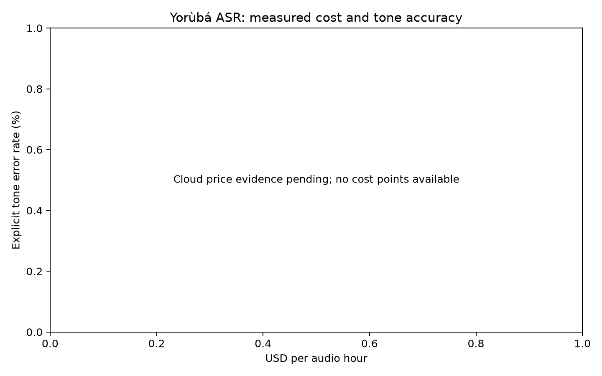

# Do tones break first when a Yorùbá speech model shrinks?

**Preliminary result:** on all 177 held-out recordings, untuned MMS Yoruba achieved
58.41% tone-stripped WER; Whisper-small achieved 143.66%. Fine-tuning and the
compression/cost comparison remain in progress.

WAXAL contains **`yor_tts`, not `yor_asr`** at the pinned revision. These are
recordings collected for TTS and repurposed here for ASR. The 2026-10-25 audit
decoded every recording with the `datasets` library:

| Published split | Recordings | Measured audio hours | Speakers |
| --- | ---: | ---: | ---: |
| Train | 2,233 | 19.169 | 8 |
| Validation | 201 | 1.785 | 8 |
| Test | 177 | 1.562 | 8 |

Every speaker appears in all splits. There are four exact transcript overlaps
between training and test, and five between training and validation. Preparation
removes held-out transcript duplicates from the training manifest. This experiment
does **not** measure generalization to unseen speakers.

| Baseline | Test recordings | Tone-stripped WER | Tone edits / all reference tones | Conditional TER | Matched words | Matched reference tones |
| --- | ---: | ---: | ---: | ---: | ---: | ---: |
| openai/whisper-small | 177 | 143.66% | 0.37% | 88.89% | 0.80% | 0.41% |
| facebook/mms-1b-all | 177 | 58.41% | 10.47% | 20.62% | 55.75% | 50.77% |



Both baselines above ran on a Kaggle T4 using the same pinned corpus and chunk policy.
Whisper’s conditional TER has only 0.41% reference-tone coverage; read it with the
coverage column. These are baseline measurements, not compression effects.
The all-reference denominator requested in the study brief is included too;
Whisper's small value reflects very few matching words and cannot establish
better tone accuracy.

The measurement table is in [the report](report/report.md); machine-readable
observations are in [report/runs](report/runs). `null` costs mean no cloud price or
controlled cloud measurement has been supplied. They do not mean free inference.

```bash
python3.12 -m venv .venv
. .venv/bin/activate
pip install -e '.[dev,inference]'
pytest -q
python -m data.prepare                    # Allow about 4 GB including 16-kHz audio
python -m eval.run --manifest data/prepared/test.jsonl --backend ct2 \
  --model Systran/faster-whisper-tiny --compute-type int8 --out report/runs/tiny-int8
# Exact Hugging Face baselines need the training dependencies:
pip install -e '.[training]'
python -m eval.run --manifest data/prepared/test.jsonl --backend whisper \
  --model openai/whisper-small --out report/runs/whisper-small
python -m eval.run --manifest data/prepared/test.jsonl --backend mms \
  --model facebook/mms-1b-all --out report/runs/mms-yor
```

`yo` is Whisper's Yoruba code; MMS uses the `yor` adapter. Long audio is decoded
with the backend's documented segmentation policy; do not compare runs with
different policies as if quantization were their only difference.

On a Kaggle GPU, with Internet enabled and this repository checked out:

```bash
pip install -e '.[training,inference]'
python -m data.prepare
for size in tiny base small; do
  python -m train.finetune --size "$size" --out "checkpoints/$size"
  bash scripts/compress.sh "checkpoints/$size/best" "models/$size" /path/to/whisper.cpp /path/to/whisper
done
```

Checkpoints are selected by validation WER. Utterances longer than 30 seconds are
excluded as whole examples during training and validation checkpoint selection;
the counts are saved. The complete test set remains intact. Each size has four
conditions—float, int8, q5_0 and q4_0—so the complete matrix has **12 versions**.
Use `bash scripts/build_whisper_cpp.sh /outside/repo/converter-source` to build the pinned converter/runtime sources. Record the exact source commits of both converter repositories. The converter also
exports CT2 float32 and retains the whisper.cpp f16 file as controls. Compare
quantized versions with the full-precision control from the same backend, since
conversion and decoding can change results independently of quantization.

The pinned tools have compiled and their CLI entry points have been checked;
[toolchain evidence](report/conversion-toolchain.json) distinguishes this from
actual model conversion. For CPU conversion, install
`pip install -r requirements-conversion.txt` to use the recorded CPU PyTorch
build. A submitted Kaggle job can be collected with `python -m train.collect_gpu
--kernel OWNER/SLUG/VERSION --out /private/external/output`; collection starts
no compute and keeps raw SDK logs outside the repository.
`python -m train.convert_collected --help` describes the finite follow-on
conversion step. It checks selected-weight fingerprints against complete test
evaluations, then creates the CT2 and whisper.cpp conditions. Its output is
labelled as awaiting inference validation; conversion alone is not a result.

```bash
/path/to/whisper-server -m models/tiny/ggml-model-q4_0.bin -t 4 --host 127.0.0.1 --port 8080
# In a second terminal; server/model/thread settings must match:
python -m eval.run --manifest data/prepared/test.jsonl --backend cpp \
  --model models/tiny/ggml-model-q4_0.bin --cpp-server-url http://127.0.0.1:8080 \
  --out report/runs/tiny-q4
python -m eval.error_review report/runs/tiny-q4/predictions.jsonl
python -m eval.report report/runs/*/summary.json
```

For CPU cloud runs, supply `--server-hourly-usd` and a public `--price-source` URL.
Cost per audio hour is `real_time_factor × hourly_server_price`. Keep hardware,
thread count, decoding settings, sample set and warmup fixed across comparisons.
The local shared-host timings are exploratory and cannot establish cloud costs.
The CLI fallback includes process/model startup for every recording and is rejected
for steady-state cost calculations. The persistent server includes local HTTP and
audio-upload overhead; record it when comparing backends.

WER removes only U+0300 and U+0301 after Unicode NFD; underdots in ẹ, ọ and ṣ
survive. TER compares explicit-tone sequences **only inside words that match
after tone removal**, normalized by explicit reference marks in those words.
It is always accompanied by matched-word and matched-tone coverage. The optional
`reference_normalized_tone_edit_rate` uses all reference tones as its denominator;
that quantity can become misleadingly small when almost no words match.

Unmarked mid tones, tone positions within the same mark sequence, punctuation,
and incomplete reference diacritics remain limitations. A vowel-aligned tone
metric and native-speaker review are necessary before strong linguistic claims.

Read [background](report/background.md), [methods and results](report/report.md),
and [remaining work](report/completion.md). Dataset/model licenses are separate
from the MIT code license. No trained model has been uploaded yet.
